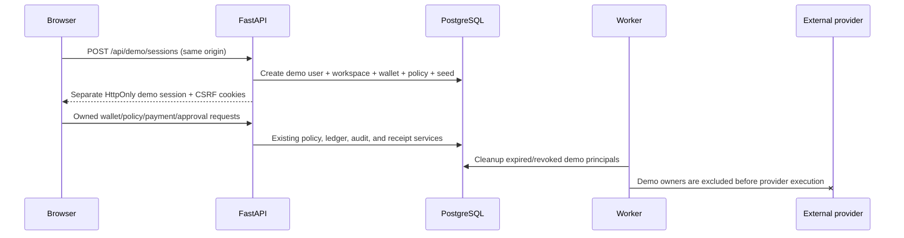

# Instant demo implementation

Status: candidate implementation locally verified; production deployment and
public acceptance are recorded separately after release.

## Architecture

Pactra retains its existing TypeScript/React frontend and Python/FastAPI,
PostgreSQL, worker, policy, ledger, approval, receipt, and audit architecture.
The instant demo adds a temporary principal type rather than a second
authentication platform.

The language choice is unchanged and recorded in
[`docs/adr/0002-instant-demo-isolation.md`](../docs/adr/0002-instant-demo-isolation.md).

## Isolation model

Each demo creation produces:

- a unique `users` row with `is_demo=true` and a random, unusable password;
- one unique `demo_workspaces` lifecycle row;
- the normal owner-scoped wallet and ledger accounts;
- versioned policies, transactions, approvals, receipts, and audit events;
- an opaque database session issued through the existing authentication
  implementation.

All existing data access continues to filter by the authenticated `user_id`.
The backend derives demo status from the authenticated user and active
workspace. No client `isDemo` flag grants access.

Normal and demo sessions use separate cookie names:

- `pactra_session` / `pactra_csrf` for normal accounts;
- `pactra_demo_session` / `pactra_demo_csrf` for instant demos.

This allows a judge to enter and exit a demo without destroying an unrelated
normal session in the same browser. Production cookie configuration remains
Secure, HttpOnly, SameSite=Lax, path `/`.

## Session lifecycle

1. `POST /api/demo/sessions` checks same-origin policy and shared database rate
   limits.
2. PostgreSQL serializes the active-capacity check with a transaction-scoped
   advisory lock.
3. The API creates and seeds one temporary owner in one transaction.
4. The API issues a short-lived opaque session using the existing session
   hash and CSRF mechanism.
5. `GET /api/auth/session` restores a valid demo after refresh. It clears an
   expired demo cookie and can then restore a separate normal session.
6. Reset locks the workspace row and the user's wallet row before replacing
   the current sandbox generation.
7. Exit marks the workspace revoked, revokes every active session belonging to
   that demo principal, and clears only demo cookies.
8. The worker deletes revoked or expired demo principals in bounded batches.

Default lifetime is 120 minutes. Absolute demo-workspace expiry is enforced in
addition to the existing session checks.

## API operations

| Method and path | Authentication | Result |
|---|---|---|
| `POST /api/demo/sessions` | Same-origin guest request | Creates and seeds one isolated demo; returns `201` |
| `GET /api/demo/session` | Active demo session | Returns expiry and seed version |
| `POST /api/demo/reset` | Demo session + CSRF | Idempotently restores the current owner's seed |
| `POST /api/demo/exit` | Demo session + CSRF | Revokes the demo and returns `204` |
| `GET /api/auth/session` | Optional cookies | Restores demo first, then a normal session if no valid demo remains |

Detailed schemas and error contracts are documented in
[`docs/instant-demo-api.md`](../docs/instant-demo-api.md).

## Seed data

Workspace: **Northstar Studio**. All names and addresses are fictional.

One versioned policy document uses the existing evaluator to express the
required controls:

- `$500.00` daily limit;
- `$750.00` per-payment limit;
- approval required above `$100.00`;
- allowed `software`, `vendor_payments`, and `operations` categories with
  category budgets;
- blocked vendor `Restricted Supply Co`.

Seeded outcomes:

| Key | Vendor | Amount | State | Ledger effect |
|---|---|---:|---|---|
| completed | Frame.io | `$35.00` | completed | captured |
| pending approval | Northstar Print House | `$140.00` | pending approval | reserved |
| rejected | Ridgeway Contractor | `$130.00` | rejected | reservation released |
| blocked | Restricted Supply Co | `$75.00` | blocked | no hold |

The current balance is posted `$965.00`, reserved `$140.00`, available
`$825.00`. It satisfies `available = posted - reserved` and agrees with the
ledger and transaction states.

## Demo workflows

- `$49.00` software request: completes through the internal sandbox after real
  deterministic policy evaluation.
- `$120.00` software request: enters pending approval because it is above the
  seeded threshold.
- Approval or rejection: uses the existing approval service and re-evaluates
  the current policy before transition.
- Restricted vendor: returns a persisted policy-blocked receipt and reason.
- Receipt: displays lifecycle, policy checks, audit events, ledger entries,
  and an explicit demo/simulated disclosure.
- Assistant: uses the deterministic parser only and labels the response as a
  demo response with no external AI call.

## Reset behavior

Reset requires a valid demo session, CSRF token, and an idempotency key.

- `SELECT ... FOR UPDATE` serializes resets for the workspace.
- The normal sandbox reset service cancels active current-generation work,
  restores the wallet, increments the generation, and writes audit evidence.
- The seeded policy and four initial scenarios are recreated through product
  services.
- Browser walkthrough progress is cleared only after the backend confirms
  success.
- A repeated idempotency key replays the successful result.
- Any exception rolls back the transaction, preserving the prior workspace.

## Exit behavior

Exit revokes the demo workspace and its active authentication sessions, then
clears the two demo cookies. It does not delete or revoke a normal account
session. Expired/revoked demo data is removed later by bounded worker cleanup.

## Provider and AI safety

Provider execution fails closed at four boundaries:

1. the transaction API rejects a non-internal rail for a demo context;
2. the transaction service rejects create, approve, retry, and reconciliation
   paths for provider-backed demo work;
3. the PayPal orchestration service rejects a missing or demo owner before any
   client method can run;
4. worker claim and scan queries join `users` and require `is_demo=false`.

The worker cleanup loop runs even when PayPal payouts are disabled. Demo
assistant calls never enter the Gemini branch, even if production AI settings
are enabled.

## Cleanup safety

Cleanup selects only workspaces that are explicitly revoked, expired, or past
their expiry. Before deletion it verifies the owner still has `is_demo=true`.
PostgreSQL migration `20261110_0006` narrows the immutable ledger and audit
triggers to permit `DELETE` only while that explicit demo-ownership proof is
true. Updates remain forbidden. Normal user journals and audit events retain
the original immutable behavior.

Deletion follows foreign-key order and is idempotent. A workspace with a
normal owner raises `DemoCleanupSafetyError` and aborts cleanup.

## Abuse controls

- per-client demo creation limit;
- global demo creation limit;
- exact active-session cap, serialized in PostgreSQL;
- per-session reset limit;
- existing payment and assistant request limits;
- hard maximum transaction count per demo principal;
- bounded cleanup batch and interval;
- opaque random session tokens and random internal demo email suffixes.

IP address is a rate-limit input, not the isolation boundary.

## Configuration

| Variable | Default | Purpose |
|---|---:|---|
| `DEMO_SESSION_TTL_MINUTES` | `120` | Absolute workspace/session lifetime |
| `DEMO_CREATION_RATE_LIMIT_PER_HOUR` | `5` | Per-client creation ceiling |
| `DEMO_CREATION_GLOBAL_RATE_LIMIT_PER_HOUR` | `200` | Shared creation ceiling |
| `DEMO_MAX_ACTIVE_SESSIONS` | `250` | Concurrent unexpired workspace cap |
| `DEMO_MAX_TRANSACTIONS` | `250` | Lifetime transaction cap per demo principal |
| `DEMO_RESET_RATE_LIMIT_PER_HOUR` | `10` | Per-workspace reset ceiling |
| `DEMO_CLEANUP_BATCH_SIZE` | `50` | Maximum principals removed per worker pass |
| `DEMO_CLEANUP_INTERVAL_SECONDS` | `300` | Worker cleanup cadence |

Defaults are safe production values; they can be reduced without changing the
session model.

## Verification status

Verified locally on 2026-11-10:

- migration `0005 -> 0006` on SQLite and isolated PostgreSQL;
- full backend suite on SQLite and PostgreSQL;
- direct service and worker provider exclusion;
- concurrent reset serialization and immutable-trigger cleanup;
- frontend lint and production build;
- four-test instant-demo Playwright journey with retries disabled;
- 48-test Chromium journey/WCAG/responsive regression suite;
- 48-test Firefox journey/WCAG/responsive regression suite;
- required responsive screenshots in `QA/DEMO/screenshots/`.

GitHub CI, production deployment, production performance, and public acceptance
are recorded in the acceptance report when completed. Local WebKit is not
claimed because this host lacks its required system libraries.

## Deployment record

- Candidate branch: `codex/instant-demo-20261110`
- Candidate SHA: pending commit
- Merged SHA: pending
- Oracle active release: pending
- Vercel production deployment: pending
- Production migration: pending (`20261110_0006` expected)
