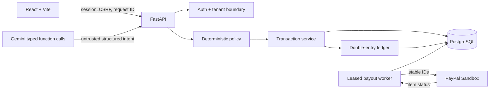

# Pactra Technical Architecture Overview

## System

## Trust boundaries

- Browser validation improves UX; backend schemas and ownership are
  authoritative.
- AI output is untrusted and cannot directly execute financial side effects.
- API creates governed state but never submits PayPal payouts.
- Worker is the sole provider submission authority and holds a PostgreSQL
  advisory lease.
- PostgreSQL constraints, row locks, unique keys, and immutability triggers
  protect financial state.
- Only item-level PayPal `SUCCESS` permits ledger capture.

## Request lifecycle

1. Authenticate session and CSRF for mutations.
2. Validate strict request schema and idempotency key.
3. Scope all reads/writes to the authenticated user.
4. Evaluate deterministic policy.
5. Block, reserve and await approval, or execute.
6. Internal sandbox posts one balanced capture immediately.
7. PayPal Sandbox persists one stable attempt for worker processing.
8. Unknown provider outcomes remain reserved and are reconciled by stable ID.
9. Receipt assembles policy, attempts, ledger, reservation, and audit evidence.

## Production topology

- Frontend: Vercel static deployment and same-origin `/api/*` rewrite.
- Backend: FastAPI/Uvicorn systemd service on Oracle VPS.
- Worker: separate systemd service.
- Database: PostgreSQL 16 on loopback.
- Public backend path: Nginx and Tailscale Funnel.
- Schema: Alembic revision `20261107_0005` in the accepted runtime.

The demo uses the same application services with an isolated SQLite database,
AI disabled by default, and PayPal disabled.
