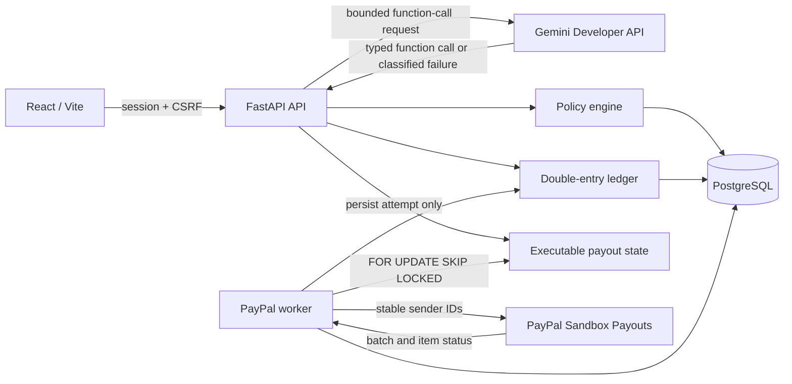
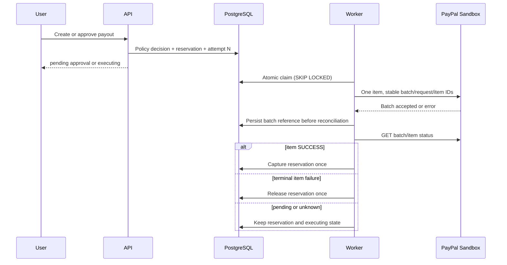

# Pactra

Pactra is an open-source, sandbox-only payment governance workspace for small teams. It lets a business define spending rules, create payment requests manually or through an AI assistant, require human approval, and inspect the receipt, audit trail, and ledger evidence for every outcome.

[Open the production application](https://pactra-nine.vercel.app) · [Read the demo guide](./DEMO/DEMO-GUIDE.md) · [Review the accepted production baseline](./QA/ACCEPTED-PRODUCTION-BASELINE.md)

Fresh visitors can select **Explore demo** to enter an isolated, populated
Northstar Studio workspace without registration or shared credentials. Demo
payments remain inside Pactra's internal sandbox and cannot enter the provider
execution path.

Current code, documentation, and UI reconciliation evidence is in
[QA/CODEBASE-README-WEBAPP-RECONCILIATION.md](./QA/CODEBASE-README-WEBAPP-RECONCILIATION.md).

> **Sandbox boundary:** Pactra does not move real money. Its wallet is a simulated double-entry ledger. The optional PayPal integration is restricted to PayPal Sandbox Payouts.

The production link points to the accepted runtime release documented in the QA records. Repository branches can contain later reviewed changes that are not yet deployed. Do not infer deployment from a Git commit alone.

## The problem Pactra solves

A normal payment form answers one question: where should money go? A governed payment system must answer several more:

- Is this category permitted?
- Is the vendor blocked?
- Is there enough available budget and wallet balance?
- Does the amount require a human decision?
- Was the request submitted, completed, rejected, failed, or left awaiting reconciliation?
- Can the business prove what happened without trusting an AI response or a provider acknowledgement?

Pactra puts a deterministic policy, approval, ownership, and ledger boundary between every request source and every execution path. Manual forms and Gemini function calls use the same authenticated transaction service. AI can interpret intent, but it cannot approve a request, bypass policy, submit a payout directly, or alter the ledger.

## What the product does

| Stage | User experience | Authoritative control |
|---|---|---|
| Configure | Set daily, per-transaction, category, vendor, and approval rules | Versioned server-side policy |
| Request | Create a payment manually or describe it to the assistant | Strict schemas, ownership, and idempotency |
| Decide | Complete, block, or route the request for approval | Deterministic policy evaluation and available funds |
| Execute | Use the internal sandbox or an authorised PayPal Sandbox worker | Worker-only provider submission and item-level truth |
| Prove | Inspect status, receipt, policy checks, attempts, audit events, and ledger entries | Persisted evidence and balanced journals |

Implemented capabilities include:

- Email and password accounts with an 8 to 128 character password policy, Argon2id hashing, opaque server-side sessions, CSRF protection, and owner-scoped records.
- A per-user double-entry sandbox ledger with issuance, top-ups, reservations, captures, releases, resets, and exactly-once compensating journals.
- Versioned limits for category, vendor, transaction, daily spend, category budget, available funds, and human approval.
- Manual and assistant-created requests that share one server-authoritative payment lifecycle.
- Conditional approval and rejection with current-policy re-evaluation.
- Internal sandbox execution that works without provider credentials.
- Worker-owned PayPal Sandbox Payouts submission and item-level reconciliation.
- Persisted receipts, policy checks, provider attempts, lifecycle events, audit evidence, and ledger entries.
- Per-session instant-demo principals with seeded policy/payment evidence,
  reset/exit controls, bounded expiry/cleanup, and normal-session preservation.
- Public Privacy Policy and Terms of Use pages, plus a responsive footer and sandbox disclosure.

## How a request becomes an outcome

1. A user creates an account and receives $1,000.00 in simulated funds.
2. The user reviews or edits the versioned spending policy.
3. A manual form or validated Gemini function call creates a request with an idempotency key.
4. The backend evaluates policy in a fixed order and persists the decision.
5. Eligible funds are reserved exactly once.
6. The request is blocked, waits for approval, or becomes executable.
7. Internal payments capture immediately. PayPal requests wait for the worker and the payout item's authoritative status.
8. The owned receipt presents policy, attempt, audit, provider, and balanced-ledger evidence.

## Architecture



Production uses Vercel for the static frontend and same-origin `/api/*` rewrite, plus FastAPI, PostgreSQL, and one systemd worker on the Oracle VPS. Tailscale Funnel terminates the public API HTTPS route. PostgreSQL and Uvicorn remain bound locally.

Instant demos reuse this architecture. The API creates a temporary `User` and
`DemoWorkspace`, issues a separate opaque cookie session, and seeds the normal
policy, approval, ledger, receipt, and audit models. The worker removes only
expired or revoked demo-owned data and excludes demo owners from every PayPal
scan.

## Technology stack

| Layer | Implementation |
|---|---|
| Frontend | React 18, TypeScript 5, Vite 8, React Router, AG Grid |
| API | FastAPI, Pydantic, SQLModel, SQLAlchemy |
| Database | PostgreSQL in production; SQLite for local/lightweight tests |
| Migrations | Alembic |
| Authentication | Argon2id, opaque database sessions, HttpOnly cookies, synchronizer CSRF token |
| AI | `google-genai` SDK, Gemini Developer API typed functions, deterministic fallback |
| Payments | PayPal Payouts REST API v1, Sandbox host only |
| Testing | Pytest, Playwright, Axe, Lighthouse, pip-audit, npm audit |
| Operations | systemd, Vercel, Tailscale Funnel |

## Product routes

| Route | Purpose |
|---|---|
| `/` | Public product page |
| `/sign-up`, `/sign-in` | Account and session entry |
| `/privacy`, `/terms` | Public privacy and terms pages |
| `/app` | Wallet, policy capacity, recent activity, and judge walkthrough |
| `/app/payments/new` | Governed manual payment or payout request |
| `/app/assistant/:conversationId?` | Persisted assistant conversation |
| `/app/approvals` | Pending approval and rejection decisions |
| `/app/transactions` | Filtered AG Grid history |
| `/app/transactions/:id` | Owned receipt, policy, provider, audit, and ledger evidence |
| `/app/policies` | Current policy editor and version history |
| `/app/wallet` | Balance, top-up, ledger history, and reset |
| `/app/settings` | Session and account controls |
| `/app/settings/integrations/paypal` | PayPal Sandbox configuration and reconciliation status |

Demo users do not receive settings routes. The public Explore demo action
creates the session through `POST /api/demo/sessions` and then opens `/app`.

QA captures branch-specific desktop, tablet, and mobile screenshots into the ignored `artifacts/` directory. The production link is the accepted deployed reference; it does not prove that later branch-only UI changes are live.

## Payment execution architecture

The API never submits a PayPal payout. It validates the request, evaluates policy, reserves funds, persists the transaction and stable provider attempt, then returns. The worker is the sole submission authority.



The sender batch and `PayPal-Request-Id` are `pactra-{transaction_uuid}-a{attempt_number}`. The sender item ID is stable for the transaction. Concurrent workers cannot both claim the same attempt. API replays and duplicate worker delivery do not create a second local attempt or provider submission.

Batch acceptance is not success. Pactra captures the ledger only after the individual payout item reports `SUCCESS`.

### Ambiguous submissions

A timeout, connection reset, provider 5xx, or malformed success response may mean PayPal accepted the request even though Pactra has no batch ID. Pactra records the attempt as `unknown`, retains the reservation, and excludes it from automatic scans.

The authenticated receipt then offers **Recover submission**. After explicit confirmation, the API changes the same attempt from `unknown` to `submitting`; the worker replays the exact same stable identifiers. A PayPal duplicate-batch response can recover the original batch reference. Pactra never creates attempt N+1 while the prior outcome is unresolved.

## Approval and policy model

Policy evaluation order is fixed:

1. Active account and wallet; USD currency.
2. Allowed category.
3. Blocked vendor.
4. Per-transaction limit.
5. Daily committed plus reserved spend.
6. Category committed plus reserved spend.
7. Available sandbox funds.
8. Human approval when amount is greater than the threshold.

The exact threshold is auto-approved; the first cent above it requires approval. Approval and rejection are conditional, idempotent state transitions. A pending request is re-evaluated if the policy changes. Expired or revoked sessions cannot act. Pactra currently uses the requesting account as the approval actor; multi-role approver separation and a request-specific approval TTL are not implemented.

## AI behaviour

When `AI_ENABLED=true`, the backend sends bounded requests to an approved Gemini model and accepts only declared typed function calls. The selected model is `gemini-3.5-flash-lite`; `gemini-3.8-flash` is retained as the documented configuration rollback. SDK retries are disabled, Pactra makes at most two 12-second attempts per model turn, and sanitized audit evidence records latency, finish reason and provider error class. Tool arguments are validated again, and payment tools call the same authenticated transaction service as the manual form. Gemini never receives provider credentials and cannot select another tenant.

The older `backend/agent.py` module is a retired, provider-free compatibility
shim. No application route imports it, and invoking its chat entry point fails
closed. The active implementation is `backend/services/assistant.py`.

If AI is disabled, quota-exhausted, times out, or returns an invalid response, Pactra records sanitized evidence and uses its deterministic fallback for supported prompts. A fallback response is labelled and is never evidence that Gemini worked.

Live compatibility, isolated governed-workflow acceptance and a genuine production `get_wallet_summary` function call passed for `gemini-3.5-flash-lite`. Production evidence is recorded in [QA/GEMINI-MODEL-COMPATIBILITY.md](./QA/GEMINI-MODEL-COMPATIBILITY.md).

## Provider integrations

### PayPal Sandbox

- Host is fixed to `https://api-m.sandbox.paypal.com` in production.
- Startup rejects live PayPal hosts, enabled payouts without credentials/recipient, and production mock mode.
- OAuth, submission, and status retrieval happen server-side.
- One Pactra payout creates one PayPal item.
- Pending, processing, unclaimed, on-hold, and unknown states retain the reservation.
- `FAILED`, `BLOCKED`, `CANCELED`, or `DENIED` release the reservation once.
- `RETURNED`, `REVERSED`, or `REFUNDED` use an exactly-once compensating ledger journal.

Production PayPal Sandbox acceptance is complete for the separately authorised
$25.00 payout. One worker submission reconciled to item-level `SUCCESS`, then
captured one reservation into one balanced journal. Mocks and fixtures remain
limited to deterministic failure-state tests and are never presented as
provider acceptance.

### Internal sandbox

The internal rail is always available to authenticated users. It moves only simulated Pactra ledger funds and never creates a PayPal object.

## Security model

- New passwords must contain 8 to 128 characters and at least three of four character classes: uppercase, lowercase, number, and symbol.
- Argon2id password hashes and timing-balanced unknown-account verification.
- Opaque, hashed, expiring database sessions with idle expiry and revocation.
- Secure/HttpOnly/SameSite cookies in production plus same-origin and CSRF checks for mutations.
- Exact CORS origins and restrictive API/frontend security headers.
- Strict Pydantic request schemas and UUID route validation.
- Owner filters on transactions, receipts, conversations, policies, approvals, wallet, and audit data.
- PostgreSQL row locks and uniqueness constraints for financial idempotency.
- Immutable posted ledger journals/entry sets and audit events in PostgreSQL.
- Shared, database-backed rate limits across API processes and restarts.
- Sanitized provider errors; no credentials, tokens, or raw provider bodies in responses or logs.
- Provider-status responses mask the globally configured Sandbox recipient.
- Sandbox-only PayPal configuration guards.
- Distinct demo principals and cookies; no shared writable demo account.
- Demo provider exclusion in the API, transaction service, PayPal service, and
  worker query.
- Bounded demo creation, active sessions, resets, transactions, expiry, and
  cleanup.

No inbound provider webhook endpoint exists, so webhook signature verification is not claimed. Reconciliation uses authenticated polling.

## Repository structure

```text
backend/                 FastAPI, models, services, migrations, worker, tests
frontend/                React application, browser tests, Lighthouse assertion
deploy/                  systemd, Vercel, Nginx examples, operations guide
QA/                      Acceptance, security, test, deployment, and release evidence
scripts/                 Isolated test-data helpers
.github/workflows/ci.yml Exact-SHA CI gates
Pactra-PRD-Judge-Ready.md Product acceptance authority
render.yaml              Legacy alternative blueprint; not active production
```

## Prerequisites

- Python 3.11.10 or compatible 3.11+
- Node.js 22.23.2 / npm
- PostgreSQL for production and concurrency tests
- Chromium dependencies for Playwright and Lighthouse

## Quick start: local development

```bash
cp .env.example .env
python3 -m venv .venv
. .venv/bin/activate
python -m pip install -r requirements-dev.txt
python -m alembic upgrade head

cd frontend
npm ci
cd ..
```

Do not place live credentials in `.env`. Use only isolated Sandbox credentials for an explicitly authorized provider test.

## Environment variables

The canonical secret-free template is [`.env.example`](./.env.example). The application reads these names:

| Variable | Purpose |
|---|---|
| `APP_ENV` | `development`, `test`, `demo`, or `production` |
| `SECRET_KEY`, `SECRET_KEY_FILE` | Session/CSRF secret; production may load a private file |
| `DATABASE_URL` | SQLAlchemy URL; PostgreSQL is required in production |
| `FRONTEND_URL`, `BACKEND_URL`, `CORS_ORIGINS` | Exact application origins |
| `SESSION_COOKIE_SECURE`, `SESSION_COOKIE_SAMESITE` | Cookie transport policy |
| `SESSION_TTL_HOURS`, `SESSION_IDLE_HOURS` | Absolute and idle session limits |
| `AUTH_REGISTRATION_RATE_LIMIT_PER_HOUR` | Per-client registration ceiling |
| `AUTH_REGISTRATION_GLOBAL_RATE_LIMIT_PER_HOUR` | Shared registration ceiling |
| `AUTH_LOGIN_GLOBAL_RATE_LIMIT_PER_MINUTE` | Shared login ceiling |
| `DEMO_SESSION_TTL_MINUTES` | Absolute instant-demo lifetime; default 120 minutes |
| `DEMO_CREATION_RATE_LIMIT_PER_HOUR`, `DEMO_CREATION_GLOBAL_RATE_LIMIT_PER_HOUR` | Per-client and shared creation ceilings |
| `DEMO_MAX_ACTIVE_SESSIONS`, `DEMO_MAX_TRANSACTIONS` | Active-workspace and per-principal resource caps |
| `DEMO_RESET_RATE_LIMIT_PER_HOUR` | Per-demo reset ceiling |
| `DEMO_CLEANUP_BATCH_SIZE`, `DEMO_CLEANUP_INTERVAL_SECONDS` | Worker cleanup bounds |
| `AI_ENABLED` | Enable the Gemini path only when a key is present |
| `GEMINI_API_KEY`, `GEMINI_MODEL` | Server-only Gemini credential and model |
| `GEMINI_REQUEST_TIMEOUT_SECONDS`, `GEMINI_REQUEST_ATTEMPTS`, `MAX_CHAT_HISTORY` | AI bounds; attempts are limited to 1–2 |
| `PAYPAL_PAYOUTS_ENABLED` | Enable the worker-owned PayPal rail |
| `PAYPAL_CLIENT_ID`, `PAYPAL_CLIENT_SECRET` | PayPal Sandbox business-app credentials |
| `PAYPAL_BASE_URL` | Must be `https://api-m.sandbox.paypal.com` in production |
| `PAYPAL_TEST_RECIPIENT_EMAIL` | Configured Sandbox recipient |
| `PAYPAL_MOCK_MODE` | Must be `false` in production and provider acceptance |
| `PAYPAL_REQUEST_TIMEOUT_SECONDS` | Provider request timeout |
| `POLICY_CONFIG_PATH` | Optional path to the default policy JSON file |
| `VITE_API_URL` | Optional browser API origin; blank for same-origin rewrite |
| `SEED_DEMO_ACCOUNT` | Legacy local-seed guard; keep `false`; instant demos are created per session by the API |

## Running the application

Backend:

```bash
.venv/bin/python -m uvicorn backend.main:app --reload --host 127.0.0.1 --port 8000
```

Worker:

```bash
.venv/bin/python -m backend.worker
```

Frontend:

```bash
cd frontend
npm run dev -- --host 127.0.0.1 --port 5173
```

Development OpenAPI is at <http://127.0.0.1:8000/docs>. Production disables API documentation.

## Database and migrations

Create or advance the schema:

```bash
python -m alembic upgrade head
python -m alembic current
```

Migration `20261110_0006` adds `users.is_demo`, `users.display_name`, and the
`demo_workspaces` lifecycle table. In PostgreSQL it also narrows ledger/audit
immutability functions so deletion is allowed only while the database can
prove the owner is an expired or revoked demo principal. Normal-owner updates
and deletions remain forbidden.

After `0006`, an application rollback must use a migration-aware artifact that
contains the `0006` Alembic revision. A release whose graph ends at `0005`
cannot pass the API unit's pre-start migration check against a database stamped
`0006`. Do not perform an unsafe database downgrade. See
[QA/DEPLOYMENT-AND-ROLLBACK.md](./QA/DEPLOYMENT-AND-ROLLBACK.md).

## API overview

The authoritative request/response schemas are generated from `backend/main.py` and `backend/schemas.py`. Main groups are:

- `/api/auth/*` - register, login, session, password change, logout.
- `/api/demo/sessions`, `/api/demo/session`, `/api/demo/reset`, `/api/demo/exit` - instant-demo lifecycle.
- `/api/wallet*` - balance, top-up, ledger, reset.
- `/api/policy`, `/api/policies`, `/api/spend-summary` - policy and capacity.
- `/api/transactions*`, `/api/approvals*` - preview, create, history, receipt, approval, rejection, retry, reversal, reconciliation/recovery.
- `/api/chat`, `/api/conversations*` - assistant and persisted history.
- `/api/judge/*` - guided test instrumentation.
- `/api/integrations/paypal/status` - sanitized configured state and owned provider evidence.
- `/api/health`, `/api/ready` - liveness and database/configuration readiness.

`POST /api/transactions/{id}/reconcile` never performs provider I/O in the API process. It queues either a read-only known-batch refresh or an explicit same-ID ambiguous-submission recovery for the worker.

## Tests

Backend SQLite:

```bash
APP_ENV=test DATABASE_URL=sqlite:////tmp/pactra-tests.db \
  SECRET_KEY=test-only-secret-key-at-least-32-bytes \
  PAYPAL_PAYOUTS_ENABLED=false PAYPAL_MOCK_MODE=false \
  SESSION_COOKIE_SECURE=false \
  .venv/bin/python -m alembic upgrade head

APP_ENV=test DATABASE_URL=sqlite:////tmp/pactra-tests.db \
  SECRET_KEY=test-only-secret-key-at-least-32-bytes \
  PAYPAL_PAYOUTS_ENABLED=false PAYPAL_MOCK_MODE=false \
  SESSION_COOKIE_SECURE=false \
  .venv/bin/python -m pytest -q
```

PostgreSQL uses the same commands with an isolated `postgresql+psycopg://...` URL. Never point tests at production.

Frontend and browser gates:

```bash
cd frontend
npm ci
npm run lint
npm run build
npm run test:e2e
npm audit --omit=dev --audit-level=high
npm audit --audit-level=moderate
```

Python dependency gates:

```bash
.venv/bin/python -m pip check
.venv/bin/python -m pip_audit -r requirements.txt
```

Playwright covers supported journeys and 16 automated WCAG surfaces with providers disabled. Lighthouse asserts only the homepage; it is not route-wide performance evidence.

## Instant demo

The public instant demo creates a unique temporary principal and fictional
Northstar Studio workspace through the production API. It does not use a
shared password or frontend authentication bypass. Normal registration and
login remain unchanged.

Run the complete automated rehearsal and screenshot capture:

```bash
cd frontend
DEMO_PYTHON=/absolute/path/to/pactra/.venv/bin/python npm run test:demo
```

The visitor flow, seeded data, reset/exit behavior, safety boundary, API
contracts, recovery procedure, and screenshots are indexed by
[DEMO/DEMO-GUIDE.md](./DEMO/DEMO-GUIDE.md) and
[DEMO/INSTANT-DEMO-IMPLEMENTATION.md](./DEMO/INSTANT-DEMO-IMPLEMENTATION.md).

## CI pipeline

[`.github/workflows/ci.yml`](./.github/workflows/ci.yml) runs on pushes and pull requests with read-only repository permission:

- Backend SQLite tests.
- Backend PostgreSQL tests, migration, `pip check`, and `pip-audit`.
- Frontend lint, type-check/build, production dependency audit, and full dependency audit.
- Playwright journeys, Axe WCAG checks, and homepage-only Lighthouse budgets.

Provider success is intentionally outside CI. CI mocks/fakes prove state-machine behaviour, not Gemini or PayPal acceptance.

## Deployment and monitoring

Deployment assets are under `deploy/`. The API systemd unit runs `alembic upgrade head` before Uvicorn. The worker unit is ordered after and requires the API unit, then holds a PostgreSQL advisory lease so only one worker becomes the active submission authority. The Vercel project serves `frontend/dist` and rewrites `/api/*` to the existing Funnel endpoint.

Operational checks:

```bash
curl --fail --silent http://127.0.0.1:8010/api/health
curl --fail --silent http://127.0.0.1:8010/api/ready
systemctl is-active pactra-api.service pactra-worker.service
journalctl -u pactra-api.service -u pactra-worker.service --since today
```

Readiness reports configuration, not provider success. Worker lease logs prove one active authority, not a completed payout.

Repository-contained read-only diagnostics:

```bash
python -m scripts.check_public_health \
  --base-url https://pactra-nine.vercel.app --json
python -m scripts.check_financial_invariants --json
python -m scripts.verify_backup /path/to/archive.dump \
  --sha256 <expected-sha256> --require-checksum --json
```

The public health GitHub workflow is scheduled only after its branch is merged
to the default branch. It has no paging destination. The financial checker
never repairs data, and the backup checker never restores an archive. See
[QA/OBSERVABILITY-IMPLEMENTATION.md](./QA/OBSERVABILITY-IMPLEMENTATION.md),
[QA/ALERTING-AND-INCIDENT-RUNBOOK.md](./QA/ALERTING-AND-INCIDENT-RUNBOOK.md),
and [QA/BACKUP-VERIFICATION-RUNBOOK.md](./QA/BACKUP-VERIFICATION-RUNBOOK.md).

## Failure recovery and rollback

- Lost API response: retry with the same client idempotency key.
- Pending approval: re-evaluate current policy before deciding.
- PayPal timeout/5xx/incomplete response: retain reservation and mark the attempt unknown.
- Unknown without batch ID: use **Recover submission** once; the worker reuses the same provider IDs.
- Known batch pending: queue a worker refresh; never submit a replacement batch.
- Terminal item failure: release once; an explicit later retry creates attempt N+1.
- Provider return/reversal/refund: post one compensating journal.
- Worker restart: resume from persisted submitting/processing attempts and stable IDs.
- Current deployment failure: use the same-schema `73fdfb6` rollback first;
  never point legacy `0e3e905` at a database stamped `0005`.

The full backup, deployment, health, migration, and rollback procedure is in [QA/DEPLOYMENT-AND-ROLLBACK.md](./QA/DEPLOYMENT-AND-ROLLBACK.md).

## Known limitations

- All balances and transfers are Sandbox-only.
- Gemini compatibility, isolated workflow acceptance and live production
  function calling pass for `gemini-3.5-flash-lite`.
- PayPal Sandbox acceptance is proven for the separately authorised $25 payout; this Gemini change does not alter that integration or its records.
- Production runs release `63f2583` at migration `20261107_0005`.
- Provider webhooks are not implemented; reconciliation uses polling.
- Approval uses the requesting account; separate approver roles and approval-request TTL are not implemented.
- SQLite cannot prove PostgreSQL locking, triggers, or multi-process concurrency.
- Lighthouse coverage is homepage-only.
- Demo video recording/upload remains an owner task.

The complete engineering, operations, QA, and demo handover is indexed in
[QA/FINAL-ENGINEERING-HANDOVER.md](./QA/FINAL-ENGINEERING-HANDOVER.md).

## Roadmap

Planned, not implemented:

- Separate requester/approver roles and approval expiry policy.
- Signed PayPal webhooks as a complement to polling.
- Additional currencies and production payment rails after a separate security/compliance design.
- Route-level performance budgets and real-user monitoring.

## Contributing

Work on a feature branch. Keep provider tests deterministic unless a separate Sandbox operation is explicitly authorized. Add regression coverage for critical state changes, run the full relevant gates, update the README-to-product matrix, and open a pull request without secrets or generated local artifacts. See [CONTRIBUTING.md](./CONTRIBUTING.md).

## Licence

Pactra is licensed under the [MIT License](./LICENSE).
