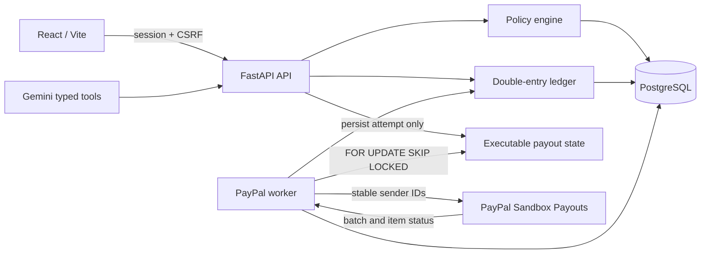
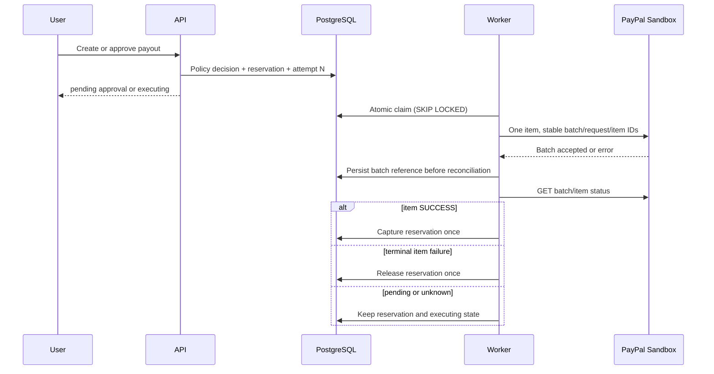

# Pactra

Pactra is a sandbox-only payment operations workspace for creating governed payment requests, applying spending policy, obtaining human approval, and tracing every ledger and provider transition.

Current production application (release `0e3e905`; this branch is not deployed): <https://pactra-nine.vercel.app>

> Pactra does not move real money. The in-app wallet is a simulated double-entry ledger. The optional PayPal integration uses PayPal Sandbox Payouts only.

## What Pactra does

Teams need more than a payment form when an AI assistant can propose spending. Pactra places an authenticated policy and ledger boundary between every request source and every execution rail. Manual requests and Gemini tool calls use the same transaction service; neither can bypass policy, approval, wallet, ownership, or idempotency checks.

Implemented capabilities include:

- Email/password accounts with Argon2id, opaque server-side sessions, CSRF protection, and owner-scoped records.
- A per-user, double-entry sandbox ledger with top-ups, reservations, captures, resets, retries, and compensating reversals.
- Versioned limits for category, vendor, transaction, daily spend, budget, available funds, and human approval.
- Manual and assistant-created payment requests using one server-authoritative transaction lifecycle.
- Atomic approval and rejection with current-policy re-evaluation.
- Internal sandbox execution available without provider credentials.
- Worker-owned PayPal Sandbox Payouts submission and item-level reconciliation.
- Persisted transaction receipts, policy checks, provider attempts, audit events, and ledger entries.
- A seven-step judge walkthrough covering the six payment outcomes plus reset/repeatability.

## Product workflow

1. A user creates a sandbox account and receives $1,000.00 of simulated funds.
2. The user reviews or edits a versioned spending policy.
3. A manual form or Gemini tool call creates a payment request with an idempotency key.
4. The backend evaluates policy in a deterministic order and persists the decision.
5. Eligible funds are reserved exactly once.
6. The request is blocked, waits for approval, or becomes executable.
7. Internal payments capture immediately. PayPal requests wait for the worker and provider item truth.
8. The receipt exposes the policy, attempt, audit, provider, and balanced-ledger evidence owned by that user.

## Architecture



Production uses Vercel for the static frontend and same-origin `/api/*` rewrite, plus FastAPI, PostgreSQL, and one systemd worker on the Oracle VPS. Tailscale Funnel terminates the public API HTTPS route. PostgreSQL and Uvicorn remain bound locally.

## Technology stack

| Layer | Implementation |
|---|---|
| Frontend | React 18, TypeScript 5, Vite 8, React Router, AG Grid |
| API | FastAPI, Pydantic, SQLModel, SQLAlchemy |
| Database | PostgreSQL in production; SQLite for local/lightweight tests |
| Migrations | Alembic |
| Authentication | Argon2id, opaque database sessions, HttpOnly cookies, synchronizer CSRF token |
| AI | Gemini REST integration with typed functions and deterministic fallback |
| Payments | PayPal Payouts REST API v1, Sandbox host only |
| Testing | Pytest, Playwright, Axe, Lighthouse, pip-audit, npm audit |
| Operations | systemd, Vercel, Tailscale Funnel |

## Product routes

| Route | Purpose |
|---|---|
| `/` | Public product page |
| `/sign-up`, `/sign-in` | Account and session entry |
| `/app` | Wallet, policy capacity, recent activity, and judge walkthrough |
| `/app/payments/new` | Governed manual payment or payout request |
| `/app/assistant/:conversationId?` | Persisted assistant conversation |
| `/app/approvals` | Pending approval and rejection decisions |
| `/app/transactions` | Filtered AG Grid history |
| `/app/transactions/:id` | Owned receipt, policy, provider, audit, and ledger evidence |
| `/app/policies` | Current policy editor and version history |
| `/app/wallet` | Balance, top-up, ledger history, and reset |
| `/app/settings` | Session and account controls |
| `/app/settings/integrations/paypal` | PayPal Sandbox configuration and reconciliation status |

QA captures genuine desktop, tablet, and mobile screenshots into the ignored `artifacts/` directory so stale binaries are not presented as permanent release evidence. The public application above is the current visual reference.

## Payment execution architecture

The API never submits a PayPal payout. It validates the request, evaluates policy, reserves funds, persists the transaction and stable provider attempt, then returns. The worker is the sole submission authority.



The sender batch and `PayPal-Request-Id` are `pactra-{transaction_uuid}-a{attempt_number}`. The sender item ID is stable for the transaction. Concurrent workers cannot both claim the same attempt. API replays and duplicate worker delivery do not create a second local attempt or provider submission.

Batch acceptance is not success. Pactra captures the ledger only after the individual payout item reports `SUCCESS`.

### Ambiguous submissions

A timeout, connection reset, provider 5xx, or malformed success response may mean PayPal accepted the request even though Pactra has no batch ID. Pactra records the attempt as `unknown`, retains the reservation, and excludes it from automatic scans.

The authenticated receipt then offers **Recover submission**. After explicit confirmation, the API changes the same attempt from `unknown` to `submitting`; the worker replays the exact same stable identifiers. A PayPal duplicate-batch response can recover the original batch reference. Pactra never creates attempt N+1 while the prior outcome is unresolved.

## Approval and policy model

Policy evaluation order is fixed:

1. Active account and wallet; USD currency.
2. Allowed category.
3. Blocked vendor.
4. Per-transaction limit.
5. Daily committed plus reserved spend.
6. Category committed plus reserved spend.
7. Available sandbox funds.
8. Human approval when amount is greater than the threshold.

The exact threshold is auto-approved; the first cent above it requires approval. Approval and rejection are conditional, idempotent state transitions. A pending request is re-evaluated if the policy changes. Expired or revoked sessions cannot act. Pactra currently uses the requesting account as the approval actor; multi-role approver separation and a request-specific approval TTL are not implemented.

## AI behaviour

When `AI_ENABLED=true`, the backend sends bounded requests to the configured Gemini model and accepts only declared typed function calls. Tool arguments are validated again, and payment tools call the same authenticated transaction service as the manual form. Gemini never receives provider credentials and cannot select another tenant.

If AI is disabled, quota-exhausted, times out, or returns an invalid response, Pactra records sanitized evidence and uses its deterministic fallback for supported prompts. A fallback response is labelled and is never evidence that Gemini worked.

The configured production readiness endpoint currently reports AI configured and enabled, but the latest recorded live generation returned `429 RESOURCE_EXHAUSTED`; genuine Gemini function calling remains unverified.

## Provider integrations

### PayPal Sandbox

- Host is fixed to `https://api-m.sandbox.paypal.com` in production.
- Startup rejects live PayPal hosts, enabled payouts without credentials/recipient, and production mock mode.
- OAuth, submission, and status retrieval happen server-side.
- One Pactra payout creates one PayPal item.
- Pending, processing, unclaimed, on-hold, and unknown states retain the reservation.
- `FAILED`, `BLOCKED`, `CANCELED`, or `DENIED` release the reservation once.
- `RETURNED`, `REVERSED`, or `REFUNDED` use an exactly-once compensating ledger journal.

Production readiness currently reports PayPal configured. Existing provider evidence includes successful Sandbox OAuth and a prior terminally denied test payout; no item-level `SUCCESS` has been demonstrated. Mocks and fixtures are used only for deterministic failure-state tests and are never presented as provider acceptance.

### Internal sandbox

The internal rail is always available to authenticated users. It moves only simulated Pactra ledger funds and never creates a PayPal object.

## Security model

- Argon2id password hashes and timing-balanced unknown-account verification.
- Opaque, hashed, expiring database sessions with idle expiry and revocation.
- Secure/HttpOnly/SameSite cookies in production plus same-origin and CSRF checks for mutations.
- Exact CORS origins and restrictive API/frontend security headers.
- Strict Pydantic request schemas and UUID route validation.
- Owner filters on transactions, receipts, conversations, policies, approvals, wallet, and audit data.
- PostgreSQL row locks and uniqueness constraints for financial idempotency.
- Immutable posted ledger journals/entry sets and audit events in PostgreSQL.
- Shared, database-backed rate limits across API processes and restarts.
- Sanitized provider errors; no credentials, tokens, or raw provider bodies in responses or logs.
- Provider-status responses mask the globally configured Sandbox recipient.
- Sandbox-only PayPal configuration guards.

No inbound provider webhook endpoint exists, so webhook signature verification is not claimed. Reconciliation uses authenticated polling.

## Repository structure

```text
backend/                 FastAPI, models, services, migrations, worker, tests
frontend/                React application, browser tests, Lighthouse assertion
deploy/                  systemd, Vercel, Nginx examples, operations guide
QA/                      Acceptance, security, test, deployment, and release evidence
scripts/                 Isolated test-data helpers
.github/workflows/ci.yml Exact-SHA CI gates
Pactra-PRD-Judge-Ready.md Product acceptance authority
```

## Prerequisites

- Python 3.11.10 or compatible 3.11+
- Node.js 22.23.2 / npm
- PostgreSQL for production and concurrency tests
- Chromium dependencies for Playwright and Lighthouse

## Local installation

```bash
cp .env.example .env
python3 -m venv .venv
. .venv/bin/activate
python -m pip install -r requirements-dev.txt
python -m alembic upgrade head

cd frontend
npm ci
cd ..
```

Do not place live credentials in `.env`. Use only isolated Sandbox credentials for an explicitly authorized provider test.

## Environment variables

The canonical secret-free template is [`.env.example`](./.env.example). The application reads these names:

| Variable | Purpose |
|---|---|
| `APP_ENV` | `development`, `test`, or `production` |
| `SECRET_KEY`, `SECRET_KEY_FILE` | Session/CSRF secret; production may load a private file |
| `DATABASE_URL` | SQLAlchemy URL; PostgreSQL is required in production |
| `FRONTEND_URL`, `BACKEND_URL`, `CORS_ORIGINS` | Exact application origins |
| `SESSION_COOKIE_SECURE`, `SESSION_COOKIE_SAMESITE` | Cookie transport policy |
| `SESSION_TTL_HOURS`, `SESSION_IDLE_HOURS` | Absolute and idle session limits |
| `AUTH_REGISTRATION_RATE_LIMIT_PER_HOUR` | Per-client registration ceiling |
| `AUTH_REGISTRATION_GLOBAL_RATE_LIMIT_PER_HOUR` | Shared registration ceiling |
| `AUTH_LOGIN_GLOBAL_RATE_LIMIT_PER_MINUTE` | Shared login ceiling |
| `AI_ENABLED` | Enable the Gemini path only when a key is present |
| `GEMINI_API_KEY`, `GEMINI_MODEL` | Server-only Gemini credential and model |
| `GEMINI_REQUEST_TIMEOUT_SECONDS`, `MAX_CHAT_HISTORY` | AI bounds |
| `PAYPAL_PAYOUTS_ENABLED` | Enable the worker-owned PayPal rail |
| `PAYPAL_CLIENT_ID`, `PAYPAL_CLIENT_SECRET` | PayPal Sandbox business-app credentials |
| `PAYPAL_BASE_URL` | Must be `https://api-m.sandbox.paypal.com` in production |
| `PAYPAL_TEST_RECIPIENT_EMAIL` | Configured Sandbox recipient |
| `PAYPAL_MOCK_MODE` | Must be `false` in production and provider acceptance |
| `PAYPAL_REQUEST_TIMEOUT_SECONDS` | Provider request timeout |
| `VITE_API_URL` | Optional browser API origin; blank for same-origin rewrite |
| `SEED_DEMO_ACCOUNT` | Optional development seed; `false` in production |

## Running the application

Backend:

```bash
.venv/bin/python -m uvicorn backend.main:app --reload --host 127.0.0.1 --port 8000
```

Worker:

```bash
.venv/bin/python -m backend.worker
```

Frontend:

```bash
cd frontend
npm run dev -- --host 127.0.0.1 --port 5173
```

Development OpenAPI is at <http://127.0.0.1:8000/docs>. Production disables API documentation.

## Database and migrations

Create or advance the schema:

```bash
python -m alembic upgrade head
python -m alembic current
```

Candidate migration `20261107_0005` adds the empty `rate_limit_buckets` table and expiry index. It does not rewrite existing user, wallet, transaction, ledger, or audit rows. Downgrade removes the table and therefore deletes stored rate-limit windows.

The production release `0e3e905` knows migrations only through `0004`. Its pre-start Alembic command cannot start against a database stamped `0005`. A rollback must stop both Pactra services, use candidate migration code to downgrade to `0004`, switch the release symlink, then start the old API and worker. See [QA/DEPLOYMENT-AND-ROLLBACK.md](./QA/DEPLOYMENT-AND-ROLLBACK.md).

## API overview

The authoritative request/response schemas are generated from `backend/main.py` and `backend/schemas.py`. Main groups are:

- `/api/auth/*` — register, login, session, password change, logout.
- `/api/wallet*` — balance, top-up, ledger, reset.
- `/api/policy`, `/api/policies`, `/api/spend-summary` — policy and capacity.
- `/api/transactions*`, `/api/approvals*` — preview, create, history, receipt, approval, rejection, retry, reversal, reconciliation/recovery.
- `/api/chat`, `/api/conversations*` — assistant and persisted history.
- `/api/judge/*` — guided test instrumentation.
- `/api/integrations/paypal/status` — sanitized configured state and owned provider evidence.
- `/api/health`, `/api/ready` — liveness and database/configuration readiness.

`POST /api/transactions/{id}/reconcile` never performs provider I/O in the API process. It queues either a read-only known-batch refresh or an explicit same-ID ambiguous-submission recovery for the worker.

## Tests

Backend SQLite:

```bash
APP_ENV=test DATABASE_URL=sqlite:////tmp/pactra-tests.db \
  SECRET_KEY=test-only-secret-key-at-least-32-bytes \
  PAYPAL_PAYOUTS_ENABLED=false PAYPAL_MOCK_MODE=false \
  SESSION_COOKIE_SECURE=false \
  .venv/bin/python -m alembic upgrade head

APP_ENV=test DATABASE_URL=sqlite:////tmp/pactra-tests.db \
  SECRET_KEY=test-only-secret-key-at-least-32-bytes \
  PAYPAL_PAYOUTS_ENABLED=false PAYPAL_MOCK_MODE=false \
  SESSION_COOKIE_SECURE=false \
  .venv/bin/python -m pytest -q
```

PostgreSQL uses the same commands with an isolated `postgresql+psycopg://...` URL. Never point tests at production.

Frontend and browser gates:

```bash
cd frontend
npm ci
npm run lint
npm run build
npm run test:e2e
npm audit --omit=dev --audit-level=high
npm audit --audit-level=moderate
```

Python dependency gates:

```bash
.venv/bin/python -m pip check
.venv/bin/python -m pip_audit -r requirements.txt
```

Playwright covers supported journeys and 14 automated WCAG surfaces with providers disabled. Lighthouse asserts only the homepage; it is not route-wide performance evidence.

## CI pipeline

[`.github/workflows/ci.yml`](./.github/workflows/ci.yml) runs on pushes and pull requests with read-only repository permission:

- Backend SQLite tests.
- Backend PostgreSQL tests, migration, `pip check`, and `pip-audit`.
- Frontend lint, type-check/build, production dependency audit, and full dependency audit.
- Playwright journeys, Axe WCAG checks, and homepage-only Lighthouse budgets.

Provider success is intentionally outside CI. CI mocks/fakes prove state-machine behaviour, not Gemini or PayPal acceptance.

## Deployment and monitoring

Deployment assets are under `deploy/`. The API systemd unit runs `alembic upgrade head` before Uvicorn. The worker starts only after API readiness and holds a PostgreSQL advisory lease. The Vercel project serves `frontend/dist` and rewrites `/api/*` to the existing Funnel endpoint.

Operational checks:

```bash
curl --fail --silent http://127.0.0.1:8010/api/health
curl --fail --silent http://127.0.0.1:8010/api/ready
systemctl is-active pactra-api.service pactra-worker.service
journalctl -u pactra-api.service -u pactra-worker.service --since today
```

Readiness reports configuration, not provider success. Worker lease logs prove one active authority, not a completed payout.

## Failure recovery and rollback

- Lost API response: retry with the same client idempotency key.
- Pending approval: re-evaluate current policy before deciding.
- PayPal timeout/5xx/incomplete response: retain reservation and mark the attempt unknown.
- Unknown without batch ID: use **Recover submission** once; the worker reuses the same provider IDs.
- Known batch pending: queue a worker refresh; never submit a replacement batch.
- Terminal item failure: release once; an explicit later retry creates attempt N+1.
- Provider return/reversal/refund: post one compensating journal.
- Worker restart: resume from persisted submitting/processing attempts and stable IDs.
- Candidate deployment failure after `0005`: follow the stopped-service downgrade procedure; do not point `0e3e905` at a database stamped `0005`.

The full backup, deployment, health, migration, and rollback procedure is in [QA/DEPLOYMENT-AND-ROLLBACK.md](./QA/DEPLOYMENT-AND-ROLLBACK.md).

## Known limitations

- All balances and transfers are Sandbox-only.
- Genuine Gemini function calling remains blocked by provider quota/entitlement evidence despite production configuration being present.
- PayPal Sandbox OAuth/configuration is not item-level payout success. No current evidence shows a payout item reaching `SUCCESS` and reconciling through this candidate.
- The worker-only correction on this branch is not deployed; production remains `0e3e905` at migration `0004`.
- Provider webhooks are not implemented; reconciliation uses polling.
- Approval uses the requesting account; separate approver roles and approval-request TTL are not implemented.
- SQLite cannot prove PostgreSQL locking, triggers, or multi-process concurrency.
- Lighthouse coverage is homepage-only.
- Demo video recording/upload remains an owner task.

## Roadmap

Planned, not implemented:

- Separate requester/approver roles and approval expiry policy.
- Signed PayPal webhooks as a complement to polling.
- Additional currencies and production payment rails after a separate security/compliance design.
- Route-level performance budgets and real-user monitoring.

## Contributing

Work on a feature branch. Keep provider tests deterministic unless a separate Sandbox operation is explicitly authorized. Add regression coverage for critical state changes, run the full relevant gates, update the README-to-product matrix, and open a pull request without secrets or generated local artifacts. See [CONTRIBUTING.md](./CONTRIBUTING.md).

## Licence

Pactra is licensed under the [MIT License](./LICENSE).
